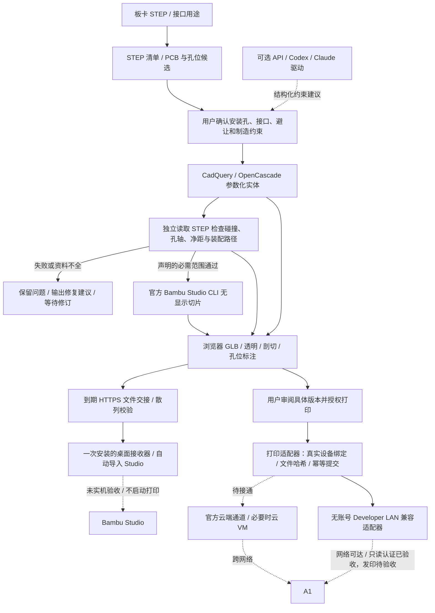

# justbuild initial architecture and module contract

Status: integrated local MVP, version `0.1`, updated 2026-10-26. The main chat owns revisions. The contracts below describe module boundaries; the implementation table distinguishes current behavior from future work.

## 当前架构与真实实现状态



设计、检查、切片、审阅流程已在合成 STEP 上运行；真实 V821 现已有按原始 STEP 生成的上下盖，当前检查和切片结果见 `docs/v821-redesign.md`。打印授权合同、幂等记录和直接 LAN 兼容适配器已有实现；A1 已完成私有配对及只读身份/固件/状态认证，真实 LAN 文件接收/启动与云打印均未验收。桌面文件交接已有服务端与 Windows 接收器代码，仍需 Windows 实机和 HTTPS 部署验收，导入不等于打印启动。图中 API 驱动是扩展边界，当前只有可调用的 Codex/Claude CLI 包装函数，尚未接入完整自动设计循环。

| 层 | 当前代码 | 已实现 / 尚待实现 |
| --- | --- | --- |
| HTTP / CLI | `server.py`, `cli.py`, `easy.py`, `easy_service.py`, `orchestrator.py` | 中文终端向导、FastAPI、磁盘任务状态、单进程串行队列；公网账户、跨机器队列和恢复待做 |
| STEP 解析与约束 | `inspection.py`, `contracts.py`, `providers.py` | 确定性候选、确认与 SHA-256 绑定；任意接口语义识别、模型 API 集成待做 |
| CAD | `cad/` | 单板上下盖、支撑柱、接口开口；默认矩形或显式原始等厚板轮廓模式，复杂非等厚结构/其他紧固方式未支持 |
| 独立检查 | `verification/`, `integration.py` | OCC 实体、真实 PCB 孔基准、孔轴、碰撞/净距/连续直线装配路径；热、RF、动作行程等缺失分析保留未检查 |
| 网页审阅 | `web/`, `review_mesh.py` | 原始网格无损合并、实际 GLB、透明/爆炸/剖切、P/L 孔位和证据；事件驱动绘制、软件像素缓冲和交互预览/静止完整恢复 |
| 切片 | `printing/`, `slicing_config.py` | 固定官方 CLI 及完整配置、回读实际 G-code/CRC/配置 |
| 桌面文件交接 | `handoff.py`, `handoff_server.py`, `receiver.py`, `receiver_install.py`, `scripts/windows-receiver.ps1` | 单文件限时能力、HTTPS下载校验、一次用户级协议安装和本地打开；Linux/Windows自动导入尚未实机验收，不发送打印指令 |
| 实际发印 | `printing/lan.py`, `print_control.py`, `printer_setup.py` | 独立于 Studio 登录的 LAN 配对/只读检查/FTPS 上传回读/MQTT 精确启动回执协议；精确版本审批和防重复已接 HTTP。A1 只读认证已通过，上传/开打仍未验收；默认云通道仍 unsupported |

### STEP 对孔位的约束

PCB 安装孔的中心、轴线与板孔直径取自原始 STEP 的机械约束，并由独立检查器重新读取 STEP 内圆柱面核验。底座导孔必须与对应 PCB 孔同轴；不能为使检查通过而移动板孔。自攻螺丝底孔与 PCB 通孔可以有不同直径，差异由紧固配置明确指定。上下盖的锁合孔属于外壳结构；当前另行布置在 PCB 外侧，网页用 L 编号，PCB 固定孔用 P 编号，避免混淆用途。

真实 V821 任务 `019d8f0d6d92426aa96618210deb469a` 使用用户提供的 `3D_V821L2WBX_1_2026-10-24.step`，原始 543 实体保留，PCB 约 99.9748 × 59.9747 × 1.58616 mm、四孔约 Ø2 mm。四孔原坐标不移动；21 个命名组件关联到访问决策与 20 个有效静态服务区域。原始孔径不同于自攻导孔，实际螺钉与装配仍需原型验收。旧合成任务不能作为本板适配结果。

### 公网多人自助打印的目标部署

浏览器通过 HTTPS 访问统一入口。各用户拥有自己的任务、产物和打印机授权；审阅分享链接只授予读取。生产部署需要账户认证、数据库和任务队列、对象存储、CAD/切片作业的资源隔离与配额，以及独立打印适配服务。打印凭据只留在服务器的专用密钥存储或官方组件中，不进入模型提示、源码、下载包或审阅链接。

最终链路为「用户浏览器 → 项目服务 → 官方云端适配 → 用户已绑定 A1」，不要求浏览器、服务器与打印机同网段。当前个人热点用于 LAN 验证；LAN 访问码和私网 IP 本身无法提供跨网络访问，也不将打印机端口直接暴露到公网。官方云端适配的许可接口、Linux 支持与端到端接收/启动仍需验证，必要时使用用户已接受的云 VM 路线。

### 本次发印状态（2026-10-24）

旧合成版在用户要求重设计后已标为停止发印；真实板新版保留审阅 hold。离线参考配置为 A1 / 0.4 mm / PLA / 0.20 mm Standard / Textured PEI，尚未读回实际设备与耗材。早先同热点候选 IP 的可达证据已过时。最新只读网络观察中电脑在 10.17.36.x 网段，旧 IP 不可达，固定 Bambu 发现窗口未找到其他候选。尚无设备授权、空闲/耗材匹配、文件接收或启动回执，未发出实际打印指令。

本机完整首次配对入口为 `/printer-setup`，需显式启用 `JUSTBUILD_ENABLE_LOCAL_PRINTER_SETUP=1` 且只通过回环地址访问。输入访问码、设备 SN/固件并明确固定证书，配置存用户目录 0600；不进入聊天、模型、源码或分享。旧 `scripts/configure_a1.py` 仅录入部分资料，不能代替完整配对。详见 `docs/printer-setup.md`、`docs/print-control.md`、`docs/printing.md`。

## Workflow

1. Import STEP/STP and extract available board/component geometry and provenance.
2. Produce a proposal covering board orientation, mounting-hole classification, connector access and unresolved mechanical information.
3. The user confirms the proposal; persist the confirmed constraints.
4. Generate a base and lid from confirmed constraints using a headless CAD kernel.
5. Run independent geometry checks. Return failed checks and bounded repair proposals. Automatic repair/retry execution is not integrated in version 0.1; a future bounded loop may retry up to three times without relaxing hard constraints.
6. Publish versioned CAD/mesh artifacts, a review model, check results and unresolved risks.
7. Slice using a pinned machine/material profile and publish the exact sliced artifact for review.
8. Submit only the artifact explicitly selected by the user's print action; preserve its hash and printer identity.

## Initial technical direction

- Python modules and JSON artifacts; optional CadQuery/OpenCascade geometry implementation.
- CLI and HTTP orchestrator with a browser review page. No desktop CAD dependency.
- Model-provider adapters are independent of geometry: API providers and noninteractive Codex/Claude runners.
- Native Linux Developer-LAN submission is a tested compatibility prototype awaiting actual device acceptance; cloud print submission remains a feasibility item, not a confirmed capability. An official-component or cloud-VM bridge is an allowed fallback. Do not assume a local gateway.
- Keep design, verification, slicing, submission and monitoring as separate operations and states.

## Common JSON envelope

Every result document includes:

```json
{
  "schema_version": "0.1",
  "job_id": "caller-supplied-id",
  "status": "ok",
  "artifacts": [],
  "issues": []
}
```

Result statuses: `ok`, `needs_input`, `failed`, `unsupported`. `ok` means only that the named module completed its declared scope. A verification result additionally has `verdict`: `pass`, `fail`, or `incomplete`. Slicing/submission must not treat `incomplete` as a release approval.

Artifact objects contain `kind`, `path`, `sha256` and `units` where relevant. Paths resolve relative to the result JSON's directory, or are absolute. Shared readers must resolve and verify paths and hashes before use.

Issue objects contain `code`, `severity` (`info`, `warning`, `error`), `message`, `feature_id` when available and `evidence` (JSON object). Do not invent numeric confidence values. Each check reports `pass`, `fail`, `not_checked` or `not_applicable`, its method, tolerance and supporting measurements.

## Request contract

Minimum common request:

```json
{
  "schema_version": "0.1",
  "job_id": "example-job",
  "board": {
    "step_path": "/absolute/input/board.step",
    "units": "mm",
    "metadata": {}
  },
  "constraints": {
    "confirmed": true,
    "structure": "single_pcb_screw_lid",
    "board_frame": {
      "origin_mm": [0, 0, 0],
      "x_axis": [1, 0, 0],
      "y_axis": [0, 1, 0],
      "z_axis": [0, 0, 1]
    },
    "mounting_holes": [],
    "ports": [],
    "keepouts": [],
    "manufacturing": {}
  }
}
```

An empty list does not prove a board has no mounting holes, ports or keepouts. Workers must return `needs_input` or explicitly incomplete results where mechanical requirements cannot be established. Metadata, hole dimensions, geometry extraction and manufacturing defaults must be documented with their sources. Workers may add module-specific fields and examples under their owned paths; proposed mandatory shared fields require main-chat integration.

Coordinates use the confirmed board frame. Hole entries identify the reference and center/axis/diameter. Ports specify an identifier, access mode (`external`, `internal`, `maintenance`, `covered`), geometry reference or explicit position/dimensions, insertion direction and any known plug/service envelope. Keepouts record geometry, purpose and provenance. Manufacturing includes material/profile identity, wall thickness, clearances and fastening parameters when supplied. Missing required values cannot become undocumented assumptions.

## Python entry points

Use `pathlib.Path` arguments. Entry points return the path to their result JSON; invalid input and geometric failure should produce structured result documents when possible.

```python
# src/justbuild/cad/__init__.py
def generate(request_path: Path, output_dir: Path) -> Path: ...

# src/justbuild/verification/__init__.py
def verify(request_path: Path, cad_result_path: Path, output_dir: Path) -> Path: ...

# src/justbuild/printing/__init__.py
def prepare_print(request_path: Path, cad_result_path: Path,
                  verification_path: Path, output_dir: Path) -> Path: ...

def submit_print(print_job_path: Path, approval_path: Path,
                 output_dir: Path) -> Path: ...
```

CAD result artifacts: at least `base_step`, `lid_step`; `assembly_step`, `base_stl`, `lid_stl` and `review_glb` when implemented. CAD results include `metadata` describing part identity, board placement, units, input provenance and generated configuration. Verification may use imported STEP geometry rather than relying solely on CAD metadata.

Verification results include `verdict`, `checks`, `repair_proposals` and the hashes of geometry checked. Define intentional support/fastener contacts explicitly; do not classify every contact as a collision. Initial path checks may be restricted to stated rigid linear assembly directions; report the restriction.

Print preparation validates the verification verdict, pins A1/nozzle/material/process profiles, and records the sliced artifact hash. Printing implementation may initially return `unsupported` with a precise reason when a real slicer or transport is unavailable. Simulation must be explicitly labeled. It must never claim an upload or real printer acceptance without evidence.

Submission requires an approval document tied to job ID, printer identity and the sliced artifact SHA-256. The main chat defines the review-action authorization mechanism. Worker implementation should fail closed until that mechanism is integrated. A timeout after submission is an unknown outcome requiring reconciliation, not an automatic retry that could start duplicate prints.

## What remains a product decision

- Default material, expected temperature/environment and thermal-information requirements.
- Standard fastening hardware, serviceability and tolerance-calibration policy.
- Policy for incomplete STEP assemblies and connector/plug model availability.
- Print-cloud component feasibility for the user's A1 firmware/account region.
- First physical reference board and printed-assembly acceptance measurements.


## 2026-10-24 后续：对话输入、直接 LAN 与网页性能

`justbuild intake BOARD.step --requirements "用户需求"` 接收几何文件与独立用户要求，返回本服务的任务链接。附件中的文本只作为数据，不提供执行授权。API 上传也接受独立 `requirements` 字段。提案中的功能语义、孔位、避让必须明确确认；当前未把任意自然语言当作已证实机械参数，模型驱动全闭环仍是后续工作。

真实 V821 的浏览模型由 43,367,816 字节无损合并为 10,713,216 字节；64,840 个 primitives 合并为 545，保留 384,357 个源三角面、节点、材质与法线。CAD 与切片散列未变。网页优先轻量文件，失败回退原始文件；产物缓存仍在授权和 SHA 校验之后，分享不能借缓存提权。见 `docs/review-mesh.md` 与 `docs/viewer-performance.md`。

配对成功后，本机 owning session 可 POST `/api/jobs/{id}/print/prepare` 准备确切设备/文件/设置/风险的 15 分钟清单，再用同来源、`X-Justbuild-Intent: print-review` 和精确清单 hash 调用 `/print`。`/print/monitor` 只查询已有尝试。`JUSTBUILD_ENABLE_LAN_PRINTING=1` 是服务器显式开关，不会自动配对或解除设计 hold。真实 V821 仍 hold，CLI 无 owner 的只读任务不能冒认 owning session。

LAN 模块不依赖桌面 Studio 进程、账号或界面操作。TLS 首次信任、设备认证、文件接收、启动回应、物理完成是不同证据；当前仅完成离线协议/控制边界测试。MQTT broker ACK 不作为设备启动 ACK，未知结果不重发。打印选项（调平、流量校准、振动校准、延时摄影、AMS、平台类型）绑定审批；层高/耗材/工艺绑定切片。

最终公网多人入口仍需各用户授权与跨网通道。远程云服务不能仅凭家庭私网 IP 直达 A1；官方云适配或可达的现场接入端仍是未验收路线。本机配对入口不允许直接当公网账号体系使用。

本机 CLI intake 的新任务会返回一次性的 `local_owner_url`（fragment），由 `/claim` 严格回环/来源/会话端点领取后才能在网页继续确认。只读 `review_url` 不授予写入；领取只绑定任务 owner，不等于确认设计或授权打印。旧真实 V821、已有 owner 和 hold 均不能通过该入口领取。非回环 base URL 应使用已认证上传 API，不签发本机领取链接。

## 2026-10-24 真实LAN首次认证

用户提供打印机屏幕资料后，电脑已回到个人热点，可直接访问目标A1；0600配对配置已建立。真实HTTP只读检查证实MQTT+FTPS认证、型号/SN/固件匹配和固定TLS证书，状态RUNNING（记录时97%）。只读查询采用实测兼容QoS0，并等待匹配版本回应和新鲜状态；局部发送完成不当作broker或设备回执。connection_verified=true、ready_for_new_print=false明确区分连接正常和设备忙。此前未发现/未配对记录是较早快照，最新连接证据在docs/lan-connection-evidence-20261024.json。没有模型上传、新打印启动、动作/温度/固件变更；云跨网与首个发印仍待验证。


## Portable entry points and reproducibility (2026-10-26)

The distributable is a Python package with CLI/HTTP/browser interfaces; no repository Skill has been shipped. A future thin Skill can instruct an agent to call these APIs, without becoming the authoritative geometry engine or bypassing review/print state.

`diagnostics.doctor_report()` inventories core distribution metadata, packaged web assets and optional slicer/model-driver prerequisites without running them or reading private printer profiles. `selfcheck.run_self_check(output_dir)` executes the existing deterministic synthetic fixture through the actual CAD and independent-verification pipeline in an instance-local manager that cannot construct an environment-configured slicer. It freshly reads BRep exports, checks standard board/holes, records a quantized semantic geometry fingerprint and refuses nonempty output directories. CLI exposes `doctor` and `self-test --out DIR`; report outcomes map to nonzero exit status when inventory or real geometry does not pass.

These are distinct acceptance levels: metadata inventory; real synthetic geometry; same confirmed real-board constraints; actual vendor slicing; printer authentication and idle state; authorized upload/start; physical completion and fit. Same source/input/request/CAD versions enable comparing dimensions, bore axes, clearances and check semantics. UUIDs, timestamps, paths and exported byte hashes need not match across regenerated jobs. Exact within-job hashes remain mandatory for provenance, approval and idempotency. A matching synthetic fingerprint is a fixture regression signal, not proof of full shape congruence or arbitrary-board semantics.

The observed runtime is Linux x86_64 CPython 3.12.3, CadQuery 2.6.1 and OCP 7.8.1.1.post1. The current venv inherits some system/site packages; no complete portable lock, clean-machine install or Docker build is yet verified. The optional Codex/Claude wrappers are not a fully integrated semantic design/repair loop. Full migration instructions and limitations are in `docs/portable-use.md`.


## Chinese terminal application (2026-10-26)

A no-argument `justbuild` now opens the Chinese assistant. `justbuild board.step` is shorthand for the `easy` command. A source-level executable locates/bootstrap-installs the dedicated headless runtime and supplies the project path; this workstation also has a nonconflicting user command in `~/.local/bin`. The menu accepts a dragged local STEP and requirements, opens existing design results, performs an explicitly selected read-only printer check, or runs the offline synthetic self-test. None of these actions approves mechanical constraints or starts printing.

`GET /api/local/workspace` is restricted to direct loopback with the existing Host/Origin/proxy guard. The terminal uses it to find the actual running service directory before creating an intake; it reuses a compatible service or makes one bounded POSIX-locked background startup attempt. Other/old services are preserved. A pending/unknown startup is not blindly repeated. Local startup binds only 127.0.0.1; logs are private0600 and startup records omit credentials/environment values.

The menu and new intake were exercised in a real PTY and through the installed command from outside the project. A real isolated background server cold-started once, then was reused and cleaned up by its owning test process. A genuine synthetic STEP intake appeared in the live review service while retaining `constraints.confirmed=false`, no CAD stage and no print stage. The previous V821 job/hold remained byte-for-byte unchanged. Scoped regression:240 passed in4.99s, one existing dependency deprecation warning. Evidence:`docs/easy-evidence-20261026.json`; user instructions:`docs/easy-use.md`. This is an easier entry, not acceptance of generic AI semantic planning, public/cloud dispatch or physical printing.


## 2026-10-26 实物反馈：紧凑结构与局部外露

用户首件试装指出整圈空隙过大、按钮与接口距离外壁过远。新提案显式采用 `manufacturing.enclosure_fit="compact"` 与 `fit_policy.id="compact-access-v1"`：普通侧隙目标0.5mm，上限1.0mm；按钮静态端面不低于局部壳面，外插接口最大凹陷0.5mm。数值是原型设计目标，实际打印公差仍需校准。旧请求省略模式时保持 legacy 布局，不覆盖旧产物。

`design_rules.py` 在提案/约束中加入可审阅目标，并在独立验证阶段从原始PCB及导出底壳/上盖STEP测量普通侧壁间隙、开口邻近壳材与静态组件端面的关系。缺失组件/局部壳面证据和超限保持必需not_checked/fail，阻止发印；静态露出不证明按压行程或完整插头啮合。紧固局部布置和局部低面板属于CAD实现，不通过缩放板卡/移动四孔/减少必需净距修复。详见 `docs/enclosure-fit-rules.md`。

## 2026-10-26 带屏扩展与可拆载架

用户确认后置110×70×3.2mm屏幕、长边平行，并接受按照片预估其余预留。显式`constraints.display.support_structure="removable_pcb_carrier"`启用底座/载架/上盖三件结构；屏幕只导出标明来源的尺寸代理。真实板四孔保持原坐标，短柱2mm。该V821修订采用已审阅的四阶段装配计划：screen → pcb_carrier → board → lid。原始543实体的板卡路径包络与三个实际小件BRep的连续平移分别检查，每阶段必须列全障碍和尚未安装部件；不能靠隐藏障碍获得装配通过。通用提案自动生成这套带屏四阶段计划尚未完成，其他调用者须显式提供完整计划，否则缺证据阻断。

主控在独立报告中接入`design_rules.fit_policy_checks`和`verification.display.display_checks`。屏幕外形、安装包络、支撑、面窗/排线静态通道和导出实体分别回读；用户允许估算不等于有效显示区、压边承载、FFC实际弯折或实体强度已验证。网页新增屏幕面、屏幕包络尺寸、可拆载架下载与分层爆炸；源模块版本用于避免旧缓存隐藏新入口。三件制造模型与屏幕尺寸证据一并绑定审阅，切片必须包含三个STL，漏载架时拒绝准备或发印。
